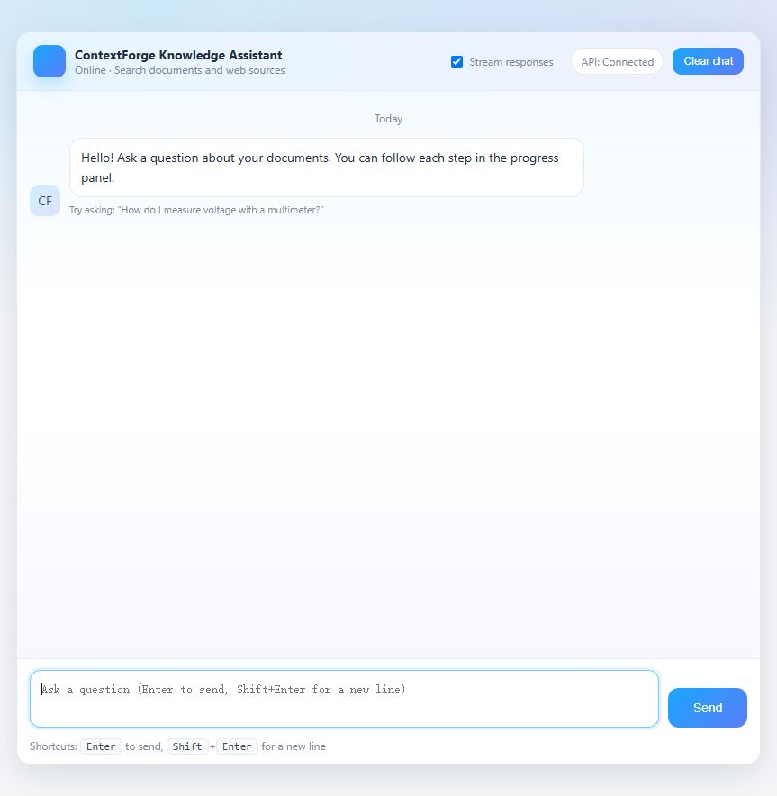
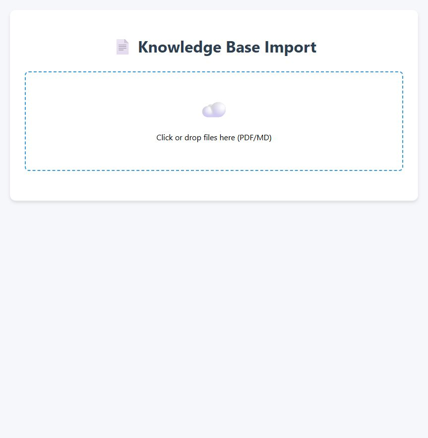

# ContextForge

ContextForge imports PDF and Markdown documents into a searchable knowledge base and answers questions through a browser chat interface. The import and query services run separately so document processing does not block chat requests.

## What it does

- Imports PDF or Markdown files, extracts text and images, splits documents into chunks, creates BGE-M3 embeddings, and writes chunks to Milvus.
- Identifies product names from documents and uses them to narrow retrieval.
- Answers questions using conversation history, vector retrieval, optional web search, reranking, and a language model.
- Stores chat history in MongoDB and can stream answers and progress to the browser.

## Requirements

- Python 3.12 or newer and [uv](https://docs.astral.sh/uv/).
- MongoDB, Milvus, MinIO, an OpenAI-compatible model endpoint, and local BGE-M3/reranker model files for the full workflow.
- MinerU for PDF conversion. The web-search MCP endpoint is optional.

Install dependencies:

```powershell
uv sync --locked
Copy-Item .env.example .env
```

Fill in `.env` with your own service endpoints, credentials, collection names, and model paths. `LLM_DEFAULT_TEMPERATURE` must contain a number. The `.env` file is ignored by Git. Model downloads and storage services must be prepared before processing documents.

## Run locally

Start the two services in separate terminals from the repository root:

```powershell
uv run contextforge import
uv run contextforge query
```

The import page is at `http://127.0.0.1:8000/import.html`; the chat page is at `http://127.0.0.1:8001/chat.html`. Use `--host` or `--port` to override a default. Each service also exposes `/docs` for its API schema.

## API

| Service | Endpoint | Purpose |
| --- | --- | --- |
| Import | `POST /upload` | Upload one or more PDF/Markdown files as multipart `files`. |
| Import | `GET /status/{task_id}` | Read import progress and status. |
| Query | `GET /health` | Check that the HTTP service is running. |
| Query | `POST /query` | Ask a question with `query`, optional `session_id`, and `is_stream`. |
| Query | `GET /stream/{session_id}` | Receive progress and answer events when streaming is enabled. |
| Query | `GET /status/{session_id}` | Read query progress and the latest answer. |
| Query | `GET /history/{session_id}` | Read recent conversation messages. |
| Query | `DELETE /history/{session_id}` | Clear a conversation. |

Example synchronous request:

```powershell
$body = @{ query = 'How do I measure voltage?'; is_stream = $false } | ConvertTo-Json
Invoke-RestMethod -Uri http://127.0.0.1:8001/query -Method Post -ContentType 'application/json' -Body $body
```

## Browser acceptance

The English import and chat pages were opened in a real browser against locally running services. The chat page showed a connected API indicator. API smoke checks covered upload and task status with mocked storage/graph dependencies, plus synchronous query and status with a mocked query graph.





The full document-to-answer path still requires the external services and model files listed above. Knowledge-graph query code in the source material is an unfinished placeholder, so this application does not route queries through it.
