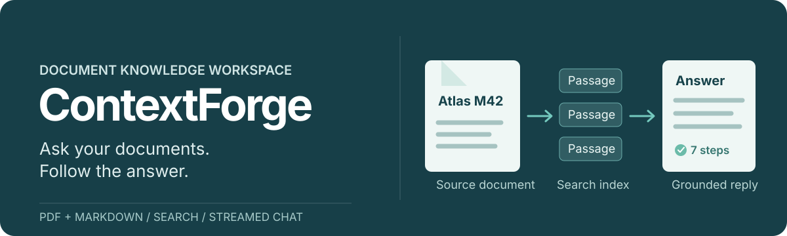

<p align="center">
  
</p>

**ContextForge** is a local document Q&A workspace. Import PDF or Markdown, watch each indexing step, and ask questions in a React chat interface that shows how an answer was produced.

**Stack:** React + TypeScript + Vite · FastAPI + LangGraph · Milvus + MongoDB + MinIO

## See it work

This is a real browser run against the included Atlas M42 sample document. The answer came from the imported document; the chat can also show [live processing](docs/screenshots/chat-processing.png) and [all completed steps](docs/screenshots/chat-progress-expanded.png).


The [import view](docs/screenshots/import-accepted.png) tracks each document through upload, extraction, splitting, embedding, and indexing.

## Try the sample

1. Start the services using [Quick start](#quick-start).
2. Upload [the Atlas M42 Markdown file](tests/fixtures/atlas-m42.md) at `http://127.0.0.1:5173/import` and wait for **Completed**.
3. Open `http://127.0.0.1:5173/chat` and ask:

   > How do I measure DC voltage with the Atlas M42?

The answer should mention **COM**, **VΩ**, **DC V**, probes placed **in parallel**, and the **600 V** maximum DC range. Expand the answer's progress row to see the seven query steps. Refresh the chat to see the conversation restored from MongoDB.

This Markdown flow was verified in a browser with the local Docker stack: the file was indexed in Milvus and the conversation was read back from MongoDB. PDF import additionally requires MinerU.

## Quick start

These commands use Windows PowerShell from the repository root. Install Python 3.12+, [uv](https://docs.astral.sh/uv/), Node.js 22.12+ with npm, and Docker Desktop. You also need an OpenAI-compatible model endpoint. The first run downloads Python dependencies and may download BGE-M3 if no local model path is configured.

1. Install dependencies and copy the example configuration:

   ```powershell
   uv sync --locked
   Copy-Item .env.example .env
   cd frontend
   npm ci
   cd ..
   ```

2. Edit `.env`: set `OPENAI_BASE_URL`, `OPENAI_API_KEY`, and `LLM_DEFAULT_MODEL`. Keep `LLM_DEFAULT_TEMPERATURE` numeric. Set `BGE_M3_PATH` to a local BGE-M3 directory, or leave it blank to download `BAAI/bge-m3`. The example storage addresses match the local Docker stack.

3. Start the databases and object store:

   ```powershell
   docker compose -f compose.local.yml up -d mongo minio milvus
   ```

4. Start the three application processes in separate terminals:

   ```powershell
   uv run contextforge import
   ```

   ```powershell
   uv run contextforge query
   ```

   ```powershell
   cd frontend
   npm run dev
   ```

Open the [import page](http://127.0.0.1:5173/import) or [chat page](http://127.0.0.1:5173/chat). Vite forwards import requests to port `8000` and query requests to port `8001`.

### Built frontend

Run `npm run build` in `frontend/`, then start or restart the query service. FastAPI serves the built React app at `http://127.0.0.1:8001/import` and `http://127.0.0.1:8001/chat`; the import API stays on port `8000`. If your APIs use other origins, set `VITE_IMPORT_API_URL` and `VITE_QUERY_API_URL` when building. The old `/import.html` and `/chat.html` URLs redirect to the React routes.

## How it works

- **Import:** upload → convert PDF when needed → process images → split passages → identify products → generate BGE-M3 vectors → store them in Milvus.
- **Ask:** identify the product → search passages and optional web results → combine and rerank results → generate a streamed answer. MongoDB stores the conversation for later visits.

The React application is in [`frontend/src`](frontend/src). The two FastAPI services and LangGraph workflows are in [`src/app/import_process`](src/app/import_process) and [`src/app/query_process`](src/app/query_process). The browser remembers import task IDs across navigation and reloads; the import API supplies their current status.

## Configuration

`.env` is ignored by Git. Copy `.env.example` and set only the integrations you use.

| Setting | Purpose |
| --- | --- |
| `OPENAI_BASE_URL`, `OPENAI_API_KEY`, `LLM_DEFAULT_MODEL` | OpenAI-compatible endpoint and model for extraction and answers. |
| `BGE_M3_PATH`, `BGE_DEVICE` | Embedding model path and device; blank path downloads the model on first use. |
| `BGE_RERANKER_LARGE` | Optional local reranker; query continues with its initial ordering if unavailable. |
| `MONGO_URL`, `MILVUS_URL` | Conversation history and vector search. |
| `MINIO_ENDPOINT`, `MINIO_ACCESS_KEY`, `MINIO_SECRET_KEY` | Document and image storage. |
| `MINERU_BASE_URL`, `MINERU_API_TOKEN` | PDF conversion; not needed for Markdown import. |
| `MCP_DASHSCOPE_BASE_URL` | Optional web-search MCP endpoint. |

The Compose stack publishes MongoDB on `127.0.0.1:27017`, MinIO on `127.0.0.1:39000` (console: `39001`), and Milvus on `127.0.0.1:39530`. Docker volumes retain data. Stop the stack with `docker compose -f compose.local.yml down`.

## HTTP API

Each FastAPI service exposes interactive documentation at `/docs` on its own port.

| Service | Endpoint | Purpose |
| --- | --- | --- |
| Import | `POST /upload` | Upload PDF or Markdown files as multipart `files`. |
| Import | `GET /status/{task_id}` | Read import status and steps. |
| Query | `GET /health` | Check service health. |
| Query | `POST /query` | Ask with `query`, optional `session_id`, and `is_stream`. |
| Query | `GET /stream/{session_id}` | Receive streamed progress and answer events. |
| Query | `GET /status/{session_id}` | Read query status and latest answer. |
| Query | `GET /history/{session_id}` | Load conversation messages. |
| Query | `DELETE /history/{session_id}` | Clear a conversation. |

A direct request without streaming:

```powershell
$body = @{ query = 'How do I measure voltage?'; is_stream = $false } | ConvertTo-Json
Invoke-RestMethod -Uri http://127.0.0.1:8001/query -Method Post -ContentType 'application/json' -Body $body
```

## Current scope

- PDF conversion needs a configured MinerU service. The verified sample uses Markdown.
- Web search requires an MCP endpoint. Knowledge-graph querying is not connected to the current answer workflow.
- The local services do not include user authentication.

## Troubleshooting

| Symptom | Check |
| --- | --- |
| A service fails on startup | Verify the model endpoint settings and numeric `LLM_DEFAULT_TEMPERATURE` in `.env`. |
| Import or search cannot reach storage | Run `docker compose -f compose.local.yml ps` and compare the local addresses above with `.env`. |
| PDF import fails while Markdown works | Configure `MINERU_BASE_URL` and `MINERU_API_TOKEN`. |
