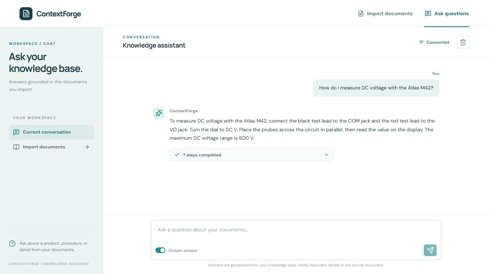
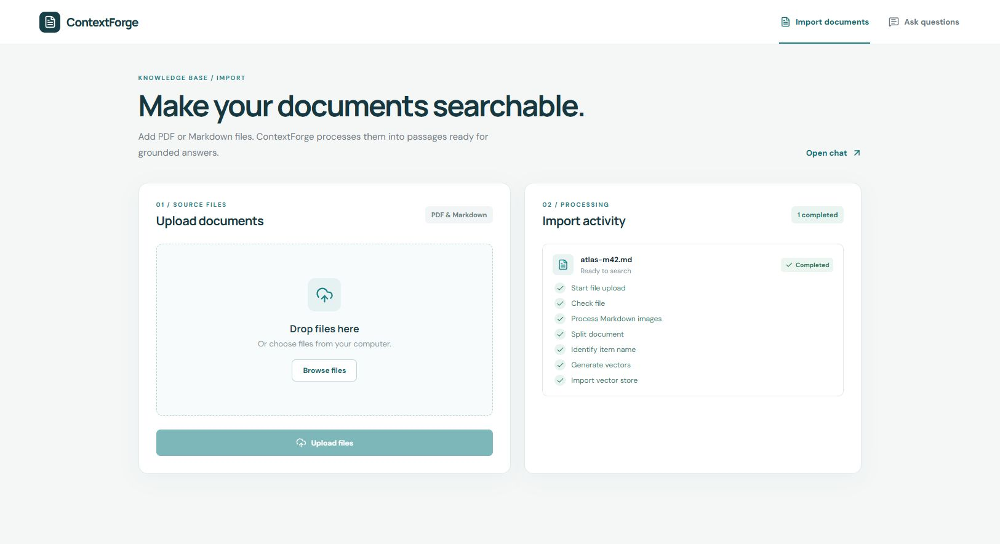

# ContextForge

Import reference documents, then ask questions against them in a browser. ContextForge turns PDF and Markdown files into a searchable knowledge base and shows each step as it builds an answer.



The chat streams answers, keeps conversation history, and lets you [inspect the processing steps](docs/screenshots/chat-progress-expanded.png). The separate [import workspace](docs/screenshots/import-accepted.png) shows the status of each document.

## What you can do

- **Build a knowledge base.** Import Markdown or PDF, process document images, split text into passages, and index dense and sparse BGE-M3 vectors in Milvus.
- **Ask grounded questions.** Find relevant passages, combine retrieval results, optionally include web search results, rerank matches, and generate an answer with an OpenAI-compatible model.
- **Follow the work.** Watch import activity and streamed answer progress in the browser. MongoDB restores conversation history when you return.

The import and query services run independently, so document processing does not block the chat interface.

## Quick start

These commands use Windows PowerShell from the repository root. You need Python 3.12+, [uv](https://docs.astral.sh/uv/), Docker Desktop, and an OpenAI-compatible model endpoint. The first installation downloads sizable Python and model dependencies.

1. Install the Python environment and create a local configuration file:

   ```powershell
   uv sync --locked
   Copy-Item .env.example .env
   ```

2. Edit `.env`. Set `OPENAI_BASE_URL`, `OPENAI_API_KEY`, and `LLM_DEFAULT_MODEL` for your model endpoint. Keep `LLM_DEFAULT_TEMPERATURE` numeric. Set `BGE_M3_PATH` to a local BGE-M3 model directory, or leave it empty to let the embedding library download `BAAI/bge-m3` on first use. `BGE_DEVICE=cpu` is the default; use a working CUDA device if available. The storage addresses in `.env.example` already match the local Docker stack.

3. Start MongoDB, MinIO, and Milvus:

   ```powershell
   docker compose -f compose.local.yml up -d mongo minio milvus
   docker compose -f compose.local.yml ps
   ```

4. Start each application service in its own terminal:

   ```powershell
   uv run contextforge import
   ```

   ```powershell
   uv run contextforge query
   ```

Open the [import workspace](http://127.0.0.1:8000/import.html), then the [chat workspace](http://127.0.0.1:8001/chat.html). Both pages link to each other. The services use ports `8000` and `8001` and bind to `127.0.0.1` by default. Run `uv run contextforge --help` to see the `--host` and `--port` options.

### Try a document end to end

Upload [the sample Atlas M42 document](tests/fixtures/atlas-m42.md) in the import workspace and wait for **Completed**. Then ask:

> How do I measure DC voltage with the Atlas M42?

A grounded answer should mention the black lead in **COM**, the red lead in **VΩ**, the **DC V** setting, probes placed **in parallel**, and the **600 V** maximum DC range. Expand the answer's completion line to review the processing steps. Refresh the chat page to confirm the conversation loads from MongoDB.

This Markdown import and question flow was verified in a real browser against the local Docker stack. The sample document was indexed in Milvus, the query returned an answer based on that document, and the conversation was read back from MongoDB.



## Configuration

Copy `.env.example` rather than editing it. `.env` is ignored by Git.

| Setting | Purpose |
| --- | --- |
| `OPENAI_BASE_URL`, `OPENAI_API_KEY`, `LLM_DEFAULT_MODEL` | OpenAI-compatible endpoint, credential, and model used for extraction and answers. |
| `BGE_M3_PATH`, `BGE_DEVICE` | Local embedding model path and execution device. A blank path triggers a model download on first use. |
| `BGE_RERANKER_LARGE` | Optional local reranker model path. The query continues with its initial ordering if the reranker cannot load. |
| `MONGO_URL`, `MILVUS_URL` | Conversation storage and vector database addresses. |
| `MINIO_ENDPOINT`, `MINIO_ACCESS_KEY`, `MINIO_SECRET_KEY` | Document and image storage. The example credentials are for local development. |
| `MINERU_BASE_URL`, `MINERU_API_TOKEN` | Required when importing PDF files; Markdown imports do not need MinerU. |
| `MCP_DASHSCOPE_BASE_URL` | Optional web-search MCP endpoint. Without it, answers use local document results. |

The local Compose file publishes MongoDB on `127.0.0.1:27017`, the application MinIO API on `127.0.0.1:39000` (console: `39001`), and Milvus on `127.0.0.1:39530`. Docker volumes preserve data between restarts. Stop the stack with `docker compose -f compose.local.yml down`.

## How it works

**Import:** upload a document → convert PDF to Markdown when needed → process images → split passages → identify product names → embed text → write vectors to Milvus.

**Query:** identify the product in the question → search document passages and optional web results → combine and rerank matches → generate and stream the answer. MongoDB stores user and assistant messages for later turns.

The source code lives under [`src/app`](src/app): `import_process` and `query_process` contain their respective LangGraph workflows and FastAPI services, while `clients` contains the storage integrations.

## HTTP API

Each service exposes interactive API documentation at `/docs` on its own port.

| Service | Endpoint | Purpose |
| --- | --- | --- |
| Import | `POST /upload` | Upload one or more PDF or Markdown files as multipart `files`. |
| Import | `GET /status/{task_id}` | Read an import task's status and steps. |
| Query | `GET /health` | Check that the HTTP service is running. |
| Query | `POST /query` | Ask a question with `query`, optional `session_id`, and `is_stream`. |
| Query | `GET /stream/{session_id}` | Receive progress and answer events for a streamed query. |
| Query | `GET /status/{session_id}` | Read query progress and the latest answer. |
| Query | `GET /history/{session_id}` | Load recent conversation messages. |
| Query | `DELETE /history/{session_id}` | Clear a conversation. |

For a direct request without streaming:

```powershell
$body = @{ query = 'How do I measure voltage?'; is_stream = $false } | ConvertTo-Json
Invoke-RestMethod -Uri http://127.0.0.1:8001/query -Method Post -ContentType 'application/json' -Body $body
```

## Current scope

- PDF conversion needs a configured MinerU service. The browser acceptance above exercises Markdown import.
- Web search is optional and needs an MCP endpoint. Knowledge-graph querying is not connected to the current answer workflow.
- The included services are configured for local development and do not implement user authentication.

If startup fails, first check that `LLM_DEFAULT_TEMPERATURE` contains a number and the model endpoint settings are present. If import or search cannot connect to storage, run `docker compose -f compose.local.yml ps` and compare the addresses in `.env` with the ports above. If PDF import fails while Markdown works, configure MinerU before retrying the PDF.
